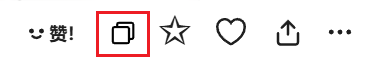

下载器会在作品缩略图上和作品页面内显示一个复制按钮，点击就可以复制作品的图片和一些数据。你可以粘贴到其他软件里保存，也可以分享给其他人。例如：

### 可以使用的场景

总体来说，有两种方式：
- 在有些场景里，下载器会显示复制按钮，点击它就可以进行复制。
- 有些场景里没有复制按钮，需要使用快捷键 `Alt` + `C`。

下面是详细说明：

#### 缩略图上的复制按钮

点击复制按钮即可复制。

此时下载器只会复制作品的第一张图片。

#### 作品页面里，图片下方的复制按钮

点击复制按钮即可复制。

此时下载器只会复制作品的第一张图片。

?>在作品页面里，可以按快捷键 `Alt` + `C` 来使用复制功能。

#### 预览作品的详细信息时

点击复制按钮即可复制。

此时下载器只会复制作品的第一张图片。

-----------

在下面的几种使用场景里，下载器都会复制当前查看的那张图片，而非固定为第一张。

#### 作品页面里，缩略图列表上的复制按钮

下载器会在多图作品页面里添加缩略图列表。点击复制按钮即可复制。

下载器会复制这张缩略图对应的图片，而非固定为第一张。

#### 预览作品时

按快捷键 `Alt` + `C` 即可复制当前查看的图片。

#### 在作品的缩略图上长按鼠标右键查看大图时

按快捷键 `Alt` + `C` 即可复制当前查看的图片。

#### 在图片查看器里

点击复制按钮，或者使用快捷键 `Alt` + `C` 即可复制当前查看的图片。

### 复制内容

你可以根据自己的需要选择复制的内容。

**每种格式的说明：**
- `image/png` 复制作品的图片。默认未选择，因为它在某些社交软件里的优先级太高，会导致 `text/html` 格式的内容被忽略。
你可以选择复制原图还是缩略图。
- `text/plain` 复制作品的文字信息。几乎所有应用程序都支持粘贴纯文本内容。
- `text/html` 同时复制作品的图片和文字信息。这是富文本格式，同时包含了上面两种内容。在 html 格式的文字内容里，下载器会为作品 ID、URL、作者名字添加超链接，但在粘贴时很多软件会移除超链接，只保留文字，所以粘贴后可能没有超链接。

**提示：**
- 这个功能在设计时的重点是同时复制图片和文字内容（`text/html`），以便于分享或存档，但实际效果取决于目标应用。有些应用可能不支持此格式，或者无法正确显示图片。
- 你可以同时选择多种格式，也就是同时复制多种内容。但是当你在应用程序里粘贴时，应用程序只会使用其中一种内容，也就是优先级最高的格式。其他格式的内容会被忽略。
- 在不同的应用程序里，优先级可能会不同。这与下载器无关。
- 例如：如果你同时复制了 `image/png` 和 `text/html` 内容，某些应用程序会使用前者，但某些应用程序可能会使用后者。如果粘贴的内容不符合你的预期，你可以取消选择其中一种格式。

### 图片尺寸

你可以选择复制的图片的尺寸：
- `原图`：默认值，下载器会复制图片的原图。需要注意的是：
- `普通`：下载器会复制图片的缩略图（最大尺寸为 1200px）。

**复制图片时的行为：**

- 下载器默认会复制原图。但是有些图片的原图比较大（例如超过 30 MiB），在某些应用程序里可能无法粘贴。如果你遇到了这种情况，可以修改“图片尺寸”为 `普通`。
- 对于插画、漫画作品，下载器会根据使用场景复制它的第一张图片，或者你查看的那张图片。
- 对于动图作品，下载器总是会复制它的静态缩略图。
- 对于小说作品，下载器总是会复制它的封面图。

### 文本格式

你可以设置下载器复制文字内容时的格式，这会影响 `text/plain` 和 `text/html` 生成的内容。

你可以使用命名规则里的所有标签，也可以输入自定义字符，例如空格、下划线、每个标签的名称。

另外，你还可以使用这些标签：

- `{url}` 这个作品的网址
- `{n}` 换行

-----------

默认的文本格式规则是 `id: {id}{n}title: {title}{n}tags: {tags}{n}url: {url}{n}user: {user}`，生成的文字内容示例如下：

id: [134304155](https://www.pixiv.net/i/134304155)

title: 黑塔

tags: #女の子,#崩壊スターレイル,#尻神様,#おっぱい,#裸足,#ヘルタ,#黑塔,#網タイツ,#AI生成作品,#崩坏星穹铁道

url: [https://www.pixiv.net/i/134304155](https://www.pixiv.net/i/134304155)

user: [光怪陆离](https://www.pixiv.net/users/95485582)

### 一些截图

我测试了粘贴的效果，PC 上的很多软件表现良好，但是在 Android 应用程序里效果不佳，所以我只建议你在 PC 上使用这个功能。

#### 浏览器

网页上的输入区域默认只能粘贴纯文本内容，也就是 `text/plain`。

某些网页应用程序可能有针对性优化，例如在 Discord 里你可以粘贴图片 `image/png`。

在 Gmail 里你可以同时粘贴图片和文字，也就是 `text/html`，例如：

#### Microsoft Word

Word 会优先采用 `text/html` 格式的内容，其次是 `image/png`，最后是 `text/plain`。例如：

#### Telegram

Telegram 不支持 `text/html` 格式，所以你无法在 Telegram 里同时粘贴图片和文字。

其他格式的优先级是：`image/png`、`text/plain`。

如果你想在 Telegram 里粘贴图片，需要选择 `image/png` 格式，这样就可以在 Telegram 里粘贴图片了：

#### QQ

QQ 的优先级是：`image/png`、`text/html`、`text/plain`。

如果你想在 QQ 里同时粘贴图片和文字，应该选择 `text/html`，并且取消勾选 `image/png`，否则它只会粘贴图片。

#### 微信

微信的优先级和 QQ 相同。你可以同时粘贴图片和文字，不过微信在发送时会把它们拆分开。例如：

#### Android 应用

Android 上的某些应用虽然可以粘贴 `text/html` 内容，但图片可能无法显示：

如果你想发送图片，需要选择 `image/png` 格式，并且取消选择其他格式。这样下载器只会复制图片，可以在一些应用里粘贴。

一些 Android 应用程序可以粘贴下载器复制的图片，例如 Telegram 和微信。但是在某些应用程序里无法粘贴图片，例如 QQ。
