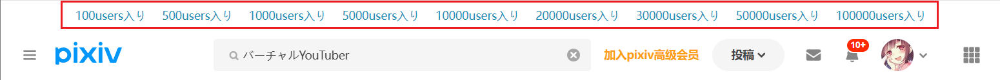

下载器会在搜索页面的顶部添加一些特定收藏数量的按钮，例如：



点击这些按钮时，下载器会在当前标签后面添加这个收藏数量的标签，并进行搜索。

例如在 `バーチャルYouTuber` 的页面里点击 `10000users入り` 按钮，下载器会自动搜索 `バーチャルYouTuber 10000users入り`。

?>这个功能对于非 Pixiv 高级会员（premium）的用户比较有用。

?> 这个功能不能保证准确。有些用户会在投稿时为作品添加 `10000users入り` 标签（实际上他的作品收藏数量很低），这是欺诈行为。

下载器添加的收藏数量按钮如下：

```
100users入り 500users入り 1000users入り 5000users入り 10000users入り 20000users入り 30000users入り 50000users入り  100000users入り
```
