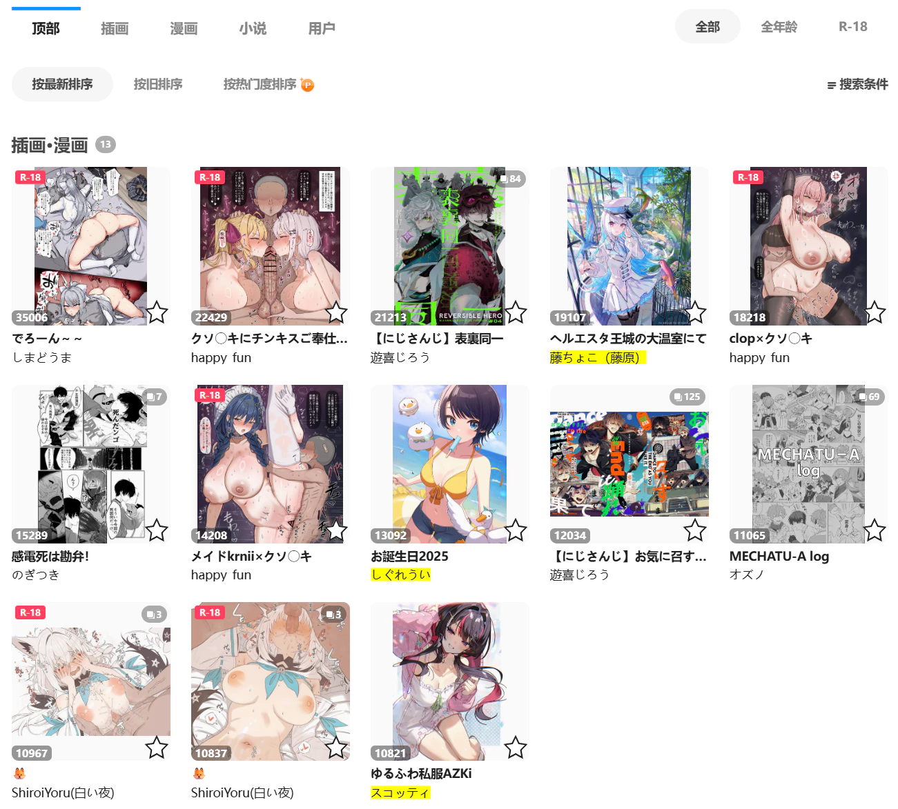

当用户在插画、漫画、动图的搜索页面抓取时，下载器会把抓取到的作品显示在当前页面里，并按照收藏数量从高到低排序。

示例：

这个功能是为了提供所见即所得的体验。你可以预览抓取结果，并且可以对抓取结果进行筛选，最后再下载。

?>在抓取完成后，你可以使用下载器的“抓取”标签页里的一些按钮对抓取结果进行筛选。

**注意：**启用这个功能时，“自动开始下载”设置不会生效。这是为了让用户在下载前有机会筛选结果，然后再下载。如果你想在抓取后自动开始下载，可以关闭这个功能。

?> 这个功能在小说的搜索页面里不会生效。

### 上限

有时候下载器抓取到的作品数量很多（例如几千个或更多），如果把它们全部显示到页面上，会使这个页面的内存使用量增加。在极端情况下，可能会导致该页面崩溃。

你可以设置“上限”来控制最多显示多少个作品，默认值是 `3000`。
