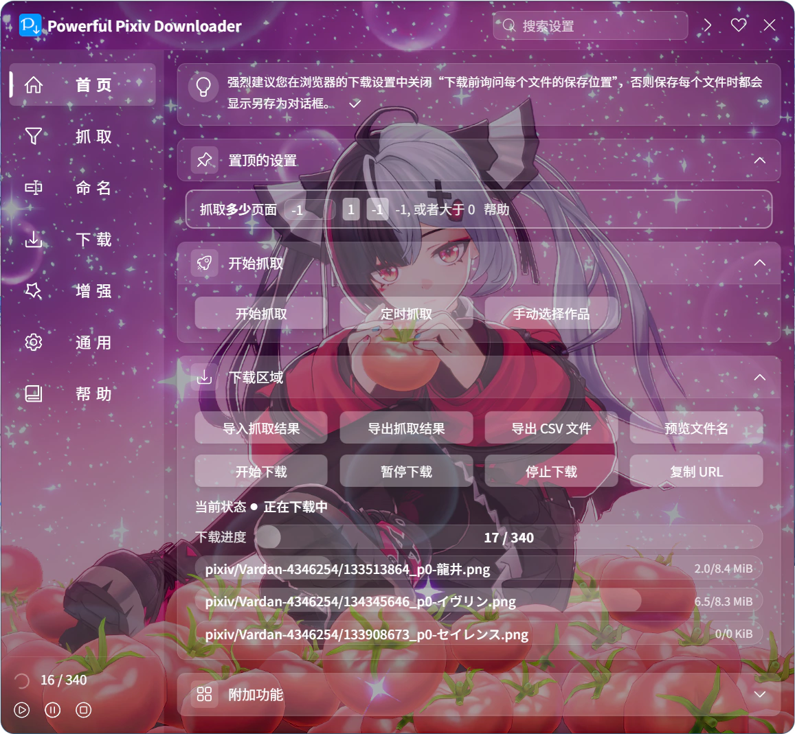

你可以把自己喜欢的图片设置成下载器的背景图片，并且可以调节透明度、对齐方式。

效果如下：

?> 下载器没有自带背景图片，所以你需要自行选择一张图片。

这个设置里有一些按钮和选项：

### 选择文件

点击这个按钮就会打开选择文件的对话框，你可以选择一张图片设置为背景图片。

?> 可以选择这些格式的图片：`.jpg,.jpeg,.png,.bmp,.webp`。

### 清除

点击这个按钮可以清除下载器的背景图片，使其恢复到没有背景图片的状态。

### 对齐方式

- `居中`：使背景图片的中间与设置面板的中间对齐。如果图片的高度大于设置面板的高度，这会导致图片的顶部和底部被裁剪。
- `顶部`：默认值。使背景图片的顶部与设置面板的顶部对齐。如果图片的高度大于设置面板的高度，这会导致图片的底部被裁剪。

你可以根据具体的图片来调整对齐方式，以获得更好的显示效果。

### 不透明度

你可以使用这个滑块来调整背景图片的不透明度。默认值是 `75%`。

?> 背景图片下方有一层黑色的背景颜色，并且背景图片默认是半透明的，所以背景图片会变暗。这个设计的目的是为了让设置面板上的文字更易阅读。调整不透明度的本质就是调整背景图片遮挡黑色背景的程度。

如果增加不透明度，图片看起来会更接近原图；如果减少不透明度，图片会变暗。
