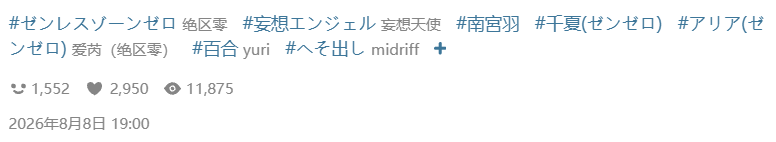
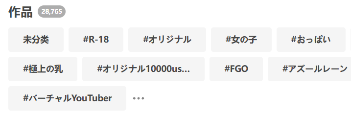

点击这个按钮，下载器会抓取你收藏里的所有未分类作品，并为它们添加标签。

当你使用这个功能时，按钮上会显示进度信息，例如：

<button id="addTagToUnmarkedWork" type="button" class="hasRippleAnimation settingsPanelActionBtn" data-btn-emphasis="secondary" data-btn-intent="brand" disabled="disabled">2 / 1330</button>

?>当这个任务开始执行后，如果你想中止任务，需要关闭当前页面。

**附加说明：**

- 该功能会抓取**所有**未分类作品，你无法设置抓取的数量。
- 该功能总是会给未分类作品添加标签。你可以在 [setting:88] 中设置使用作品原本的标签，还是翻译后的标签。这些标签就是你在它们的作品页面里看到的标签，例如：

- 该功能不会改变作品的公开状态。之前是公开收藏的，依然会是公开收藏；之前是非公开收藏的，依然会是非公开收藏。

**什么是未分类作品？**

当你添加收藏时，可以为它们添加标签（可以使自定义的标签），但这不是必须的。而且当你点击 Pixiv 的收藏按钮来添加收藏时，也是不会添加标签的。

“未分类的作品”指的是你的收藏里没有添加任何标签的作品。

?>收藏里的作品的标签是独立的，与它本身的标签无关。假如一个作品本身有 10 个标签，但是你在添加收藏时没有为它添加标签，那么它就是“未分类作品”。

**小知识：**在你的收藏页面里，Pixiv 会显示一些标签列表，例如：

这些标签就是收藏里的作品所具有的标签，按照使用次数排列。

有一个特殊的标签包含了所有未分类作品，它就是 `未分類`（这个标签名是固定的）。
