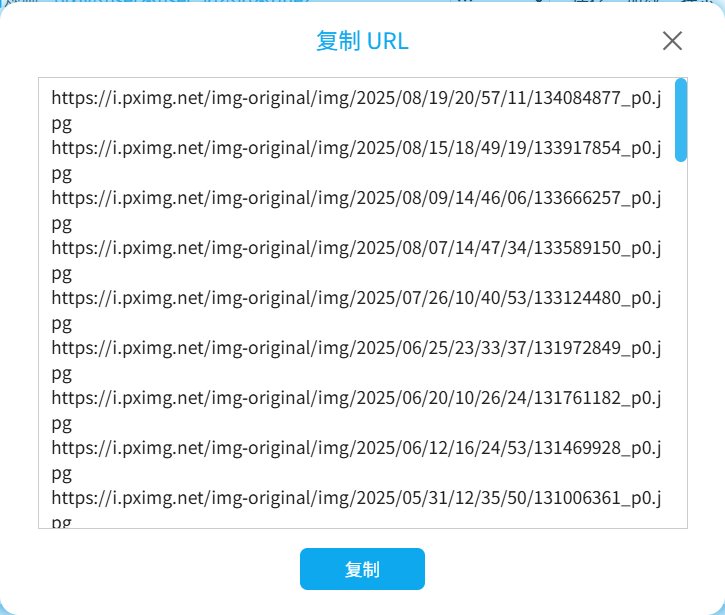

点击这个按钮，下载器会输出抓取结果里的 URL。看起来像是这样：

你可以点击 `复制` 按钮，下载器会把输入内容存入剪贴板。

如果有需要的话，你可以复制 URL 并使用其他下载软件下载。

**注意：**

下载器只会输出抓取结果里的图片的 URL。以下是对其他情况的说明：
- 对于动图作品，下载器输出的 URL 是它的原文件（Zip 文件）的网址。虽然下载器可以把动图转换成其他格式（如 WebM 视频），但转换后的文件是动态生成的，所以没有可供其他软件下载的 URL。
- 小说没有 URL，所以下载器不会输出小说的 URL。实际上 Pixiv 的服务器上并没有每个小说的 TXT 文件。下载器保存小说时，是根据小说内容动态生成文件的，所以没有可供其他软件下载的 URL。
- 有些文件不在抓取结果里，所以下载器不会输出它们的 URL。主要有两种情况：1. 有些功能会生成额外的文件，例如保存作品简介、保存作品的元数据等。它们是下载器在下载阶段动态生成的。2. 小说的封面图片、内嵌图片等，它们不是独立的抓取结果，而是小说的附属数据。

?>如果抓取结果的数量太多，出于性能考虑，下载器会把输出内容保存到一个 TXT 文件里，并保存到浏览器的下载目录里。
