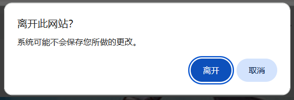

抓取已选择的作品。下载器会保留已选择的作品。

当你选择了想要抓取的作品之后，点击 `抓取选择的作品` 的按钮即可抓取和下载它们。

-----------

**提示：**

- 如果有需要，你可以通过点击 `暂停选择` 按钮和 `继续选择` 来进行多次选择。每次开始选择时，下载器不会清空之前选择的作品，所以选择的作品会累加到一起。
- 按下 `Esc` 键可以退出手动选择模式。
- 如果你选择了一些作品，下载器会在 `抓取选择的作品` 按钮上显示作品数量。
- 下载器的过滤条件对手动选择的作品也会生效，所以某些作品可能会在抓取时被排除。
- 下载器不会自动清空选择的作品，除非你点击了 `清空选择的作品` 按钮。

-------

当你进入其他页面时，**可能**会丢失选择的作品列表，这取决于当前页面内容是否被丢弃。

例如从用户主页进入作品页面是无刷新加载的，就不会丢失选择的作品。

但是进入某些页面时（例如排行榜），或者刷新页面，就会导致当前页面内容被丢弃。此时下载器会让浏览器显示一个确认窗口，如下：

如果你选择离开此页面，就会丢失选择的作品。如果取消页面跳转，就不会丢失选择的作品。

总之你不需要担心不小心丢失选择的作品，因为你有机会进行选择。
