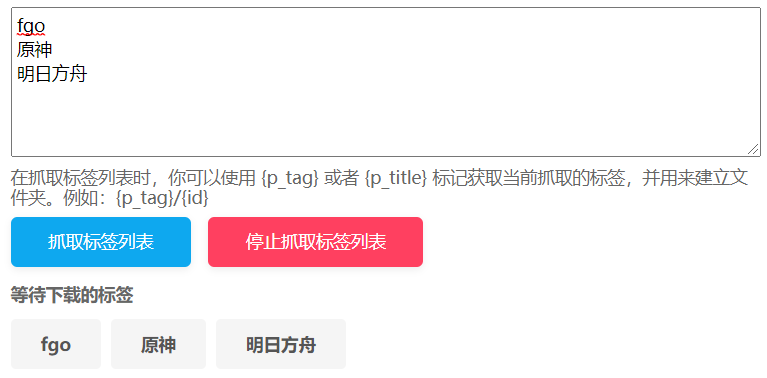

点击这个按钮之后，下载器会在网页顶部显示一个输入区域。你可以输入多个标签，下载器会依次抓取每个标签里的作品，并自动下载。

示例：

**提示：**

- 多个标签使用换行分割，即每行一个标签。
- 下载器会依次对每个标签进行抓取和下载。下载完一个标签的作品之后才会抓取下一个标签。
- 为了能够让每个标签的作品可以保存到对应的文件夹里，在抓取标签列表时，你可以使用 `{page_tag}` 标记获取当前抓取的标签，用来建立文件夹。命名规则可以参考：`{page_tag}/{id}`。
- 抓取每个标签里的作品时，下载器都会应用当前的抓取条件。
- 抓取标签列表时，不要让当前页面跳转到其他页面。（不要点击页面上的链接）
- 在抓取标签列表时，下载器不会在网页上添加抓取到的作品，也就是不能预览抓取结果。
- 下载器会保存任务状态。如果任务未完成时关闭了页面或浏览器，重新打开页面后下载器可以继续抓取剩余的标签。

------

在插画、漫画的搜索页面里，还有一些按钮可以对抓取结果进行筛选。当抓取完成后，你可以点击这些按钮从抓取结果里移除不需要的作品。
