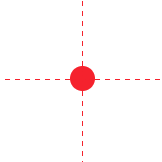
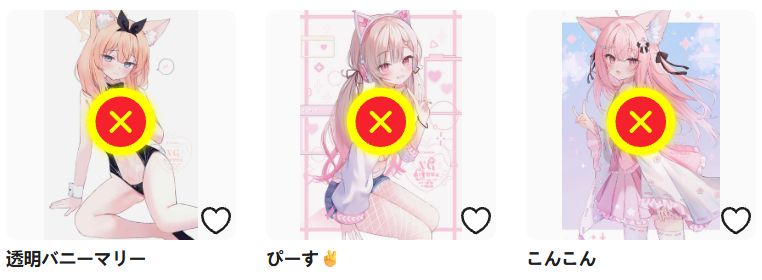

你可以使用这个按钮来排除页面上的任意作品，下载器不会抓取它们。

?>这个功能的快捷键是 `Alt` + `E`，按下即可进入/退出手动排除模式。

点击这个按钮会进入排除模式。此时鼠标光标下面会显示一个红色的圆形，并且有十字形的辅助线。如图所示：

此时你可以在任意作品上点击鼠标左键来排除它。下载器会在它上面添加一个 X 标记，表示已经排除了它。效果如下：

手动排除功能和手动选择功能有一些相似的地方，例如可以跨页码排除、点击作品时不会打开链接、可以反选。不过在使用上更自由。

**使用时机：**

手动选择功能是先选择，然后抓取；但手动排除功能随时都可以发挥作用。也就是说，你可以：
- 先排除，然后开始抓取，这样下载器就不会抓取被排除的作品
- 在抓取之后排除，此时：如果该作品尚未被抓取，下载器就不会抓取它；如果该作品已经被抓取，下载器会把它从抓取结果里删除，这样就不会下载它。

不过，如果这个作品已经被下载，那么之后再排除它就没有效果了，因为下载器不会删除它的文件。 如果你想先开始抓取，然后排除，那么我建议你关闭“抓取完成后，自动开始下载”设置，这样文件不会自动下载。当你排除完毕之后，可以手动点击“开始下载”按钮开始下载。

**选择和排除作品的互操作：**

如果一个作品已经被选择，之后使用排除模式选择它，它会直接变成被排除的状态，反之亦然。

另外，当你点击 `手动排除作品` 按钮之后，这个按钮上的文字会发生变化，根据状态显示“暂停排除”、“继续排除”。
