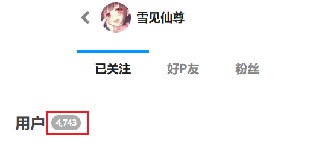

点击该按钮，下载器会根据你所在的子页面（已关注、好友、粉丝），抓取该分类下的用户的数据，并生成一个 CSV 文件，保存到浏览器的下载目录里。

你可以导出自己的关注列表作为备份，以备不时之需。

?> 虽然这个按钮里写的是“关注的用户”，但实际上也可以导出你的好友和粉丝列表。

?> 抓取多少个用户取决于“抓取多少页面”的数量。每页最多有 24 个用户。

?>使用这个功能时，下载器只会抓取用户列表，不会抓取作品。

CSV 文件里包含每个用户的以下数据：

- 用户 ID
- 用户名
- 用户主页的网址
- 用户简介
- 用户头像图片的网址

**注意：** 下载器导出的用户数量可能比网页上显示的数量少，这不是 Bug，而是因为某些用户已经注销了，所以下载器无法获取他们的数据。

例如我的关注页面里显示有 4,743 个用户：

有些用户已经注销了，但是 Pixiv 没有从总数里减去他们，这有一定误导性。不过你也许可以发现端倪：通常每页会显示 24 个用户，但有些页面里可能只有 23 个或更少的用户，这就是因为有些用户已经不存在了。

下载器在抓取数据时更容易观察到这种情况：下载器每次请求 100 个用户的数据，但 Pixiv 返回的用户数量经常是 90 多个。在抓取完成后，下载器只获得了 4,668 个用户的数据，比 Pixiv 显示的数量少了 75 个。至于被注销的用户，我无法获取他们的数据。
