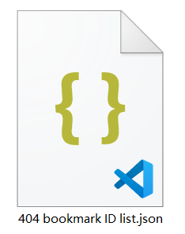

你的收藏里可能有一些已经失效的作品，你无法查看或下载它们。例如：

点击这个按钮，下载器会抓取你的收藏列表（此时不需要抓取每个作品的详细数据，所以不会花费太多时间）。然后下载器会找出**所有**已经失效的作品，并导出它们的 ID 列表到下载目录里，例如：

对于有些用户来说，导出 ID 列表的功能很有用，因为有了作品 ID，他们就有可能从其他插画网站上找到这些作品的存档。

?> 下载器只导出了作品 ID，没有包含用户 ID 等其他信息，是因为已失效的作品的数据里只有作品 ID 有意义，其他数据全部被 Pixiv 设置成了无效信息。

?> 使用这个功能时，下载器会在页面顶部的日志里显示进度信息。
