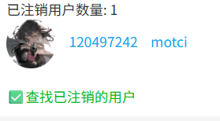

你可以查找你的关注列表里已注销的用户。

**工作原理：**
- 从该功能推出之后（2026 年 3 月），当你使用下载器时，下载器会获取一次你的关注列表并保存所有用户的数据，包括 ID、用户名、头像。该数据保存在本地，当你移除下载器时会被浏览器自动清除。
- 之后当你点击这个按钮时，下载器会重新获取你的关注列表，并与之前保存的历史数据进行比较，找出现在比之前少了哪些用户。
- 下载器逐一获取这些用户的数据，检查他们是否注销了。下载器会在顶部日志里显示进度信息。
- 检查结束后，显示结果。如果有已注销的用户，下载器会输出他们的列表，看起来可能是这样的：

**注意：**
这个功能不能查找以前注销的用户，只能查找下载器保存了历史关注数据之后注销的用户。
