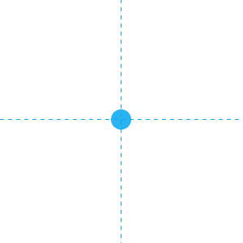
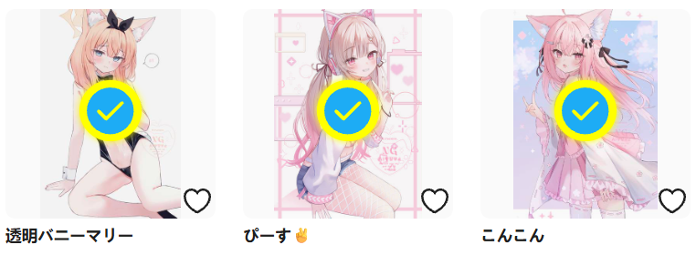

你可以使用这个按钮来手动选择页面上的任意作品，然后抓取它们。

?>这个功能的快捷键是 `Alt` + `S`，按下即可进入/退出手动选择模式。

点击这个按钮会进入选择模式。此时鼠标光标下面会显示一个蓝色的圆形，并且有十字形的辅助线。如图所示：

此时你可以在任意作品上点击鼠标左键来选择它。下载器会在它上面添加一个对号标记，表示已经选择了它。效果如下：

你可以稍后抓取已选择的作品。

**附加说明：**

- 可以跨页码选择：如果当前页面有页码（例如在用户主页里时），你可以在多个页码里选择作品。例如你可以在第 1 页里选择 2 个作品，然后进入第 2 页，选择 3 个作品。这样一共选择了 5 个作品，可以一次性抓取它们。

- 不会打开作品链接：当下载器处于手动选择模式时，点击作品不会打开它的链接，这是为了防止页面内容发生变化。如果你想查看作品页面，可以选择以下方法之一：1. 按住 `Ctrl` 键，并点击作品。2. 在作品缩略图上按鼠标右键，选择“在新标签页种打开链接”。3. 退出手动选择模式（快捷键是 `Esc`）。

- 反选：点击一个作品可以选择它；再次点击可以取消选择它。

另外，当你点击 `手动选择作品` 按钮之后，这个按钮上的文字会发生变化，根据状态显示“暂停选择”、“继续选择”。此外，这个按钮后面还会显示下面两个按钮。
