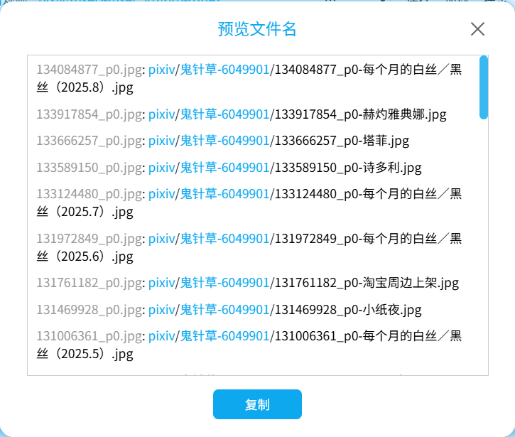

预览每个抓取结果的文件名。看起来像是这样：



下载器会为抓取每个抓取结果生成一条文本，格式为 `默认的文件名: 根据命名规则生成的文件名`，例如：

<p class="result"><span class="color999">134084877_p0.jpg</span>: <span class="colorFolder">pixiv</span>/<span class="colorFolder">鬼针草-6049901</span>/<span class="color000">134084877_p0-每个月的白丝／黑丝（2025.8）.jpg</span></p>

?> 文件名里的蓝色文字表示这是一个文件夹。

你可以点击 `复制` 按钮，下载器会把输入内容存入剪贴板。

?>如果抓取结果的数量太多，出于性能考虑，下载器会把输出内容保存到一个 TXT 文件里，并保存到浏览器的下载目录里。

这个功能对于预览文件名、编写重命名脚本都很有用。

如果你之前下载过一些文件，想把它们的名字改为下载器的命名规则生成的名字，可以先抓取它们，并复制 `预览文件名` 里的内容。然后把左侧的默认文件命修改为旧的文件名，右侧则是新的文件名（但是可能需要去掉文件夹部分），并修改为重命名命令。

举个例子，在 windows 上，你可以这样编写重命名的命令。首先复制预览的一条结果，如下：

<p class="result"><span class="color999">134084877_p0.jpg</span>: <span class="colorFolder">pixiv</span>/<span class="colorFolder">鬼针草-6049901</span>/<span class="color000">134084877_p0-每个月的白丝／黑丝（2025.8）.jpg</span></p>

可以修改成这样：

```
ren old_name.jpg 134084877_p0-每个月的白丝／黑丝（2025.8）.jpg
```

然后在该文件的目录里执行这个命令即可重命名这个文件。

?> 在批量编辑时，你可以使用一些有多行编辑模式的编辑器（例如 VS Code），提高效率。
