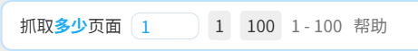

在一些页面里，随着时间推移可能会出现新的作品，例如：

- 用户主页
- 已关注用户的新作页面
- 大家的新作页面
- 自己的收藏页面
- 搜索页面

在这些页面里，如果你希望每隔一段时间就抓取一次新的作品并自动下载，就可以使用定时抓取功能。

**示例：**

如果你想定时抓取已关注的用户的新作品，可以这样做：

1. 打开 [已关注用户的作品](https://www.pixiv.net/bookmark_new_illust.php) 的页面。

2. 设置每次抓取多少页：

这个页数需要结合“间隔时间”考虑。假如你想每隔 30 分钟进行一次抓取，并且该页面在 30 分钟的新作品数量不会超过 1 页，那么就可以设置为 `1`。

3. 点击 `定时抓取` 按钮，下载器会显示一个输入框，让你设置间隔时间：

定时抓取的间隔时间 (分钟)

<input class="XZInput w100" placeholder="" type="text" value="30"><button class="XZInputButton hasRippleAnimation">
      提交
      
    </button><button class="XZInputButton cancel hasRippleAnimation">
      取消
      
    </button>

默认值是 30 分钟，你可以根据需要修改这个值。

点击 `提交` 按钮，下载器就会启动定时抓取任务，并且会在日志里显示提示：

定时抓取已启动，间隔时间：30 分钟。 如果你想修改间隔时间，可以在“更多”选项卡里修改设置：定时抓取的间隔时间。 

**提示：**

- 下载器不会立刻开始抓取，而是等到设定的时间之后才会开始第一次抓取。
- 推荐启用“更多”选项卡里的 [setting:63] 功能，以避免不必要的重复下载。
- 间隔时间不宜太短，因为抓取和下载需要一定时间。

-----------

使用定时抓取功能时，有一些需要注意的地方：

1. 不要关闭当前标签页。你可以切换到其他标签页，继续使用浏览器。
2. 不要改变当前标签页的 URL。例如当你在用户主页执行定时抓取时，如果点击某个作品进入了作品页面，就会导致定时抓取任务被取消。
3. 建议启用 [setting:63] 功能，以避免下载重复的文件。
4. 如果这个扩展程序自动更新了，那么这个页面将不能正常下载文件（需要刷新页面来恢复正常）。所以如果你想长期执行定时抓取任务，建议离线安装本扩展程序，以免因为扩展程序自动更新而导致无法继续下载。可以参考 [离线安装](/zh-cn/安装/离线安装?id=离线安装) 页面。
5. 抓取页数可以设置的少一些，以避免抓取到太多重复的作品。例如在搜索页面抓取时，最多可以抓取 1000 页，但是没有必要每次都抓取这么多页。你可以设置为抓取 10 页或更少，只要在每次抓取的间隔时间里，新内容的页数不会超过 10 页就没有问题。
6. 在搜索页面执行定时抓取时，抓取到的作品不会显示在页面上（也就是不能预览搜索结果）。
7. 在点击 `定时抓取` 按钮时，下载器会让你设置每次抓取的间隔时间。这个时间会与 [setting:29] 设置保持一致。
8. 下载器总是会使用任务开始时的间隔时间。假如你设置了每隔 10 分钟进行一次抓取，那么之后修改这个时间不会影响定时抓取任务。如果你想让修改生效，需要先点击 `取消定时抓取` 按钮，然后点击 `定时抓取` 按钮，这样下载器才会使用新的间隔时间。
