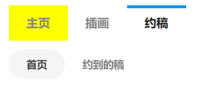

这个按钮在用户主页的“约稿”分类里使用，例如：

[koro22 的约稿页面](https://www.pixiv.net/users/42787448/request)

提示：
- 约稿页面里的作品是滚动加载的，没有分页，所以抓取数量是以作品为单位的。你可以在“抓取多少作品”里设置抓取数量。
- 约稿页面默认会显示该用户接到的约稿请求，并且会显示该用户发出的约稿（上图中的“约到的稿”）。你在哪个分类的页面里，下载器抓取的就是哪个分类里的作品。
