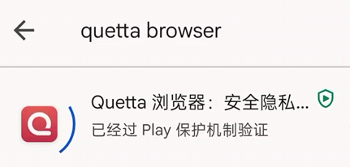
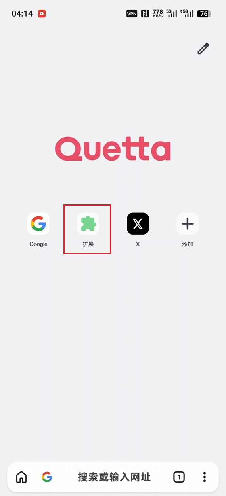
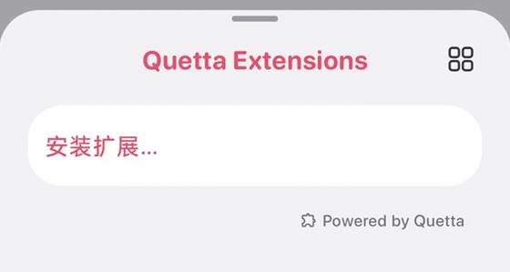
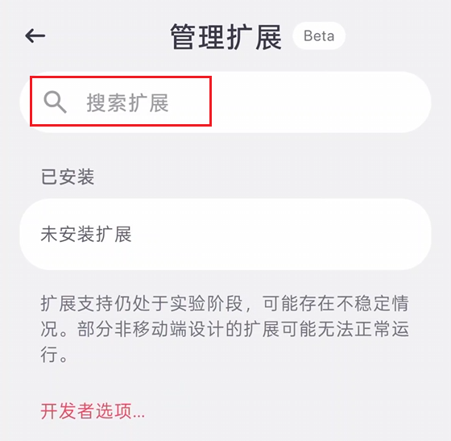
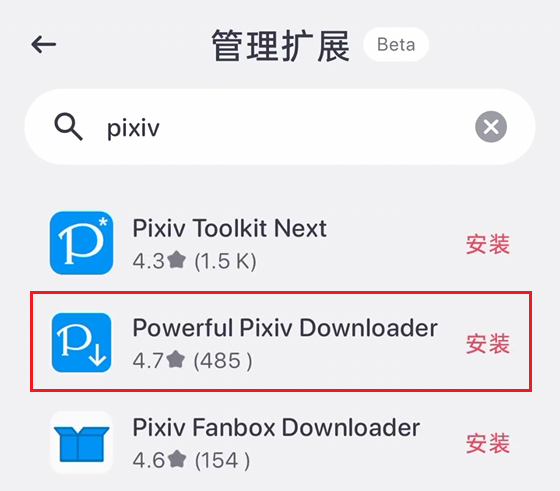
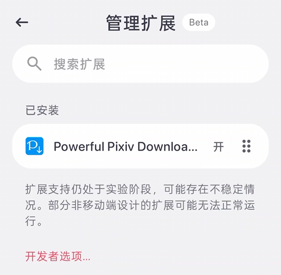
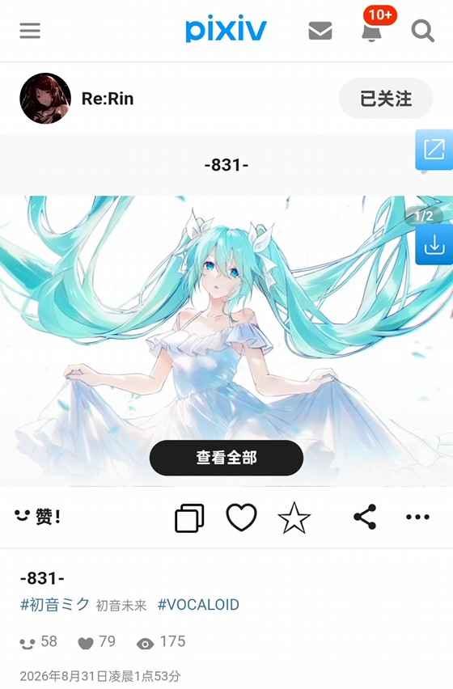
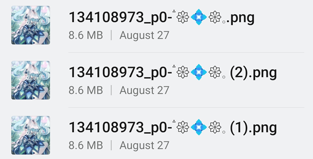

# 在移动端的 Quetta 浏览器上安装

Quetta 浏览器是一个 Chromium 内核的移动端浏览器，可以从 Chrome Web Store 在线安装扩展程序，非常方便。

## 安装步骤

从 Google Play 安装 Quetta 浏览器：

安装之后打开它，主页里有“扩展”功能：

点击它，然后选择 `安装扩展…`：

这会进入扩展管理页面，你可以搜索扩展：

输入 `pixiv` 并搜索，然后点击 `Powerful Pixiv Downloader` 右侧的安装按钮：

等到安装完成之后，返回上一页，可以看到已经安装了这个扩展：

之后打开 Pixiv 的标签页并刷新一次，应该会看到网页右侧出现了下载器的蓝色按钮：

这样就可以使用下载器了，它的大部分功能和在 PC 上一样，可以在多种页面里进行批量下载。

## 注意事项

- 下载的文件保存在手机存储里的 **Download** （下载）文件夹里。Android 上的浏览器似乎不支持修改下载目录，所以只能保存到这里。
- 下载器在 PC 上可以让浏览器建立子文件夹保存文件，但在 Android 上不行，浏览器不会建立子文件夹（这可能是系统的限制），所以文件会直接保存在下载文件夹里。这不是下载器的 BUG。
- 由于浏览器不会建立文件夹，所以下载器的命名规则只有最后一段会生效。例如默认的命名规则是 `pixiv/{user}-{user_id}/{id}-{title}`，实际上只有 `{id}-{title}` 会生效。如果你修改命名规则的话，需要注意让最后一段里包含 `{id}`，这是 pixiv 上每个文件的唯一标记，可以避免不同 ID 的作品产生相同的文件名。
- 在 PC 上，下载器重复保存同一个文件时会覆盖旧文件，但手机浏览器会保存同名文件并添加序号，例如：

- 在移动端网页里，下载器的一些增强功能不可用或者会受到影响，例如预览作品。
- 如果你的设备是横屏的（例如平板设备），可以尝试在浏览器的菜单里启用桌面模式，可以改善下载器的使用体验。这是因为下载器界面里的内容比较多，在竖屏时效率低，体验不佳。

## 页码的区别

在一些作品列表页面里，PC 版网页里的作品数量比较多，而移动端比较少。

例如在收藏页面里，PC 端一页有 48 个作品，但在移动端则是 18 个。

如果你从第一页开始抓取所有作品，那么没有影响。但如果你需要设置抓取的页码，或者从中间的某一页开始抓取，就需要注意这种区别，因为下载器目前是按照 PC 端的规则抓取的，它假设收藏页面一页有 48 个作品。

下面是一个例子。某个用户现在有 31,544 个收藏，在 PC 端有 658 页，但是在移动端有 1753 页：

**可能的影响：**

- 如果你在移动端页面里设置抓取页数为 1，那么下载器会抓取 48 个作品，而不是你看到的 18 个。
- 如果你在移动端的第 1000 页里开始抓取，下载器将无法抓取到任何作品，因为在 PC 端里没有第 1000 页。

PS：你可以使用 PC 端页面（桌面模式）来避免这种差异。

## 转换动图时让浏览器保持可见

由于 Android 系统的特性，当浏览器被切换到后台，或者设备熄屏时，它的功耗会被限制。

通常这对下载器没有太大影响，下载器依然可以正常抓取和下载文件。但是如果下载的文件里有动图，就可能会受到严重的影响。

下载器可以把 Pixiv 上的动图转换成其他格式（例如 WebM、Gif，APNG），但是转换时的 CPU 使用率会比较高。如果浏览器处于后台，或者设备熄屏，那么最差的情况是动图转换完全停止。这可能会导致下载进度卡住，无法继续下载。

在必要的时候，你应该让浏览器保持在前台，或者将其视图变为小窗模式（使其保持可见状态），以避免这个问题。
