# 安装之后

## 检查浏览器的下载设置

打开浏览器的下载设置：

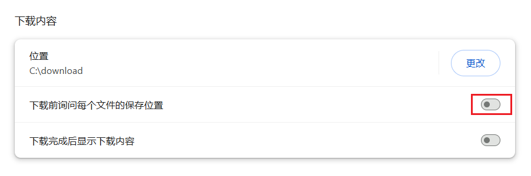

在浏览器的下载设置里，你可以确认：

1. 文件保存位置。下载器下载的文件会保存在这个目录里。

2. **关闭**“下载前询问每个文件的保存位置”，否则每下载一个文件就会弹出一次“另存为”对话框。

!>如果你已经关闭了第二项，但下载时还是出现了“另存为”对话框，可能是因为下载的文件有重名。请参考“常见问题”页面的 [下载时弹出另存为对话框](/zh-cn/常见问题?id=下载时弹出另存为对话框)。

## 如何使用

在 pixiv.net 的网页里才能使用这个扩展。如果你处于其他网站里，这个扩展程序不会生效。

安装本程序后，打开 Pixiv 的网页，可以在右侧看到一个蓝色的按钮：

点击按钮可以打开设置面板，开始抓取和下载。

## 登录 Pixiv 账号

你需要在 pixiv.net 里登录你的账号，因为不登录的话很多页面和作品都无法查看，下载器也就无法下载。

## 大量下载可能导致你的账号被封禁

如果你经常下载大量文件，请查看 [账号被封禁的风险](/zh-cn/账号被封禁的风险) 里的说明。

## 下载后的文件名异常的问题

本扩展可以对下载的文件设置自定义文件名，但是一些具有保存文件功能的扩展程序可能会导致文件名异常。

这些扩展的数量有很多（即使它们不在 Pixiv 和 Fanbox 上运行也可能会导致此问题）。在最近的反馈中，导致此问题的扩展通常是 Patreon Downloader、IDM Integration Module。

如果下载后的文件名文件名是一串随机的字母和数字，或者没有使用下载器设置里的命名规则，就表示发生了此问题。例如：

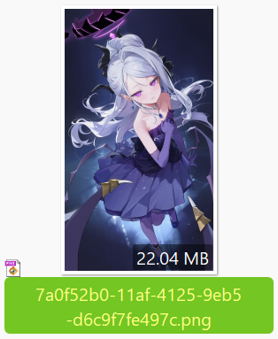

### 处理方法

如果你遇到了这个问题，可以考虑下面的处理方法：

**方法 1：**

你可以新建一个浏览器本地用户来使用这个下载器。点击浏览器右上角的头像图标，可以创建新的个人资料或配置（不需要登录浏览器厂商的账号）。每个浏览器用户的配置都是独立的，你可以在新用户的窗口里只安装这个扩展程序。当你需要下载 Pixiv 的文件时，使用这个用户进行下载，这样就不会被其他扩展程序影响。

?>我的 Pixiv 下载器和 Fanbox 下载器不会导致文件名异常。如果你有需要的话，可以在新用户的窗口里同时安装这两个扩展程序。

**方法 2：**

你可以找出导致此问题的扩展程序，并在使用本下载器时临时**禁用它们**。

这些扩展程序通常具有下载文件、管理下载的功能，例如：IDM Integration Module、Chrono 下载管理器、mage Downloade 等。如果你不确定是哪个扩展导致的，可以先禁用所有扩展，然后一个一个启用，并使用下载器进行下载，这样就可以找出是哪个扩展导致了此问题。

我在下方的 [已知的有冲突的扩展程序](/zh-cn/安装之后?id=已知的有冲突的扩展程序 ) 里列出了一些已知的会导致此问题的扩展程序。

------------

如果你要禁用某个扩展，应该在浏览器的扩展程序管理页面里禁用它。例如你要禁用 IDM Integration Module 的话，应该点击其右下角的按钮来使它不再运行：

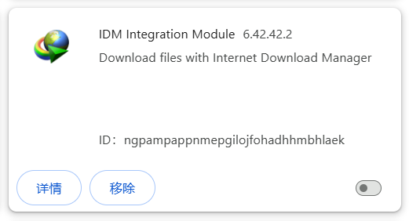

以下方法是**错误的**，它们对解决此问题毫无帮助：
- 在 IDM 的程序设置里排除 pixiv.net
- 在 pixiv.net 上点击 IDM Integration Module 的图标，使其不在该网站上生效：

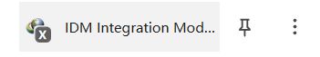

如果你使用上面两种方法，IDM Integration Module 依然是在运行的，所以问题依然存在。

### 技术细节

某些扩展程序会监听 `chrome.downloads.onDeterminingFilename` 事件，这很容易导致预设的文件名丢失。

假设本下载器为某个文件设置了自定义文件名：user/image.jpg。

如果有其他扩展程序监听了 `onDeterminingFilename` 事件，浏览器会询问它对文件名的建议（使它有机会修改文件名）。问题在于：此时浏览器传递的文件名是默认的（也就是 URL 里的最后一段路径），而不是下载器设置的文件名。

所以下载器设置的文件名会丢失，并且文件名会变成 URL 里的最后一段路径。

?>下载器没有使用这个事件，所以不会影响其他扩展程序的文件名。

### 已知的有冲突的扩展程序

下面是一些已知的会引起冲突的扩展程序：

- IDM Integration Module

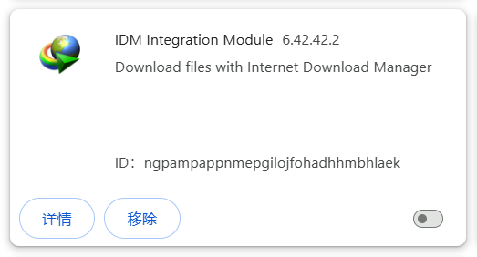

- Chrono 下载管理器

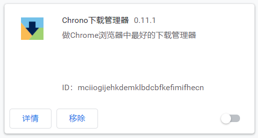

- [图片另存为JPG/PNG/WebP](https://chromewebstore.google.com/detail/save-image-as-type/gabfmnliflodkdafenbcpjdlppllnemd)

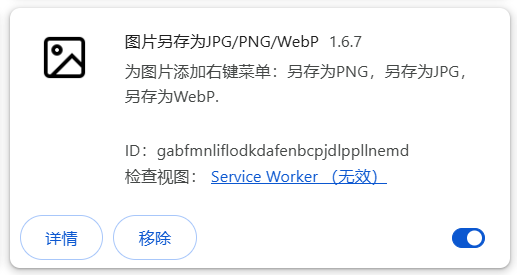

- [Video DownloadHelper](https://chromewebstore.google.com/detail/video-downloadhelper/lmjnegcaeklhafolokijcfjliaokphfk)

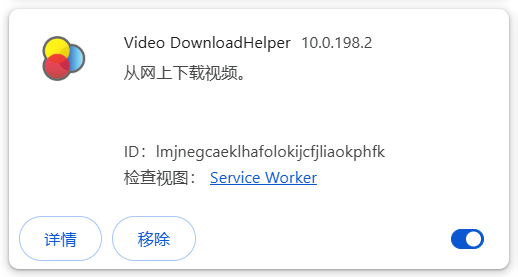

- [批量图片下载器 - Imageye](https://chromewebstore.google.com/detail/image-downloader-imageye/agionbommeaifngbhincahgmoflcikhm)

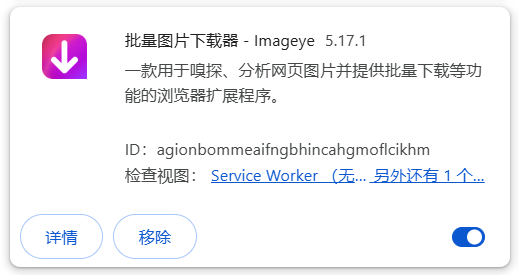

- [BitComet 扩展程序](https://chromewebstore.google.com/detail/bitcomet-download-extensi/dhigneefebkcagnpnpbibganpmfgebnk)

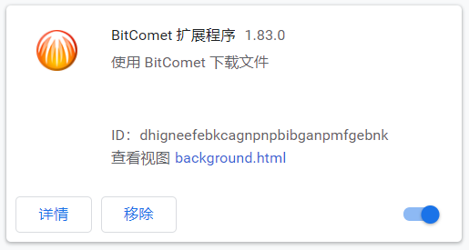

- [free Download Manager](https://chromewebstore.google.com/detail/free-download-manager/ahmpjcflkgiildlgicmcieglgoilbfdp)

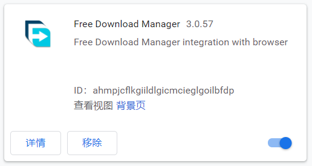

- [Media Harvest : X（Twitter）多媒体下载器](https://chromewebstore.google.com/detail/media-harvest-x%EF%BC%88twitter%EF%BC%89%E5%A4%9A/hpcgabhdlnapolkkjpejieegfpehfdok)

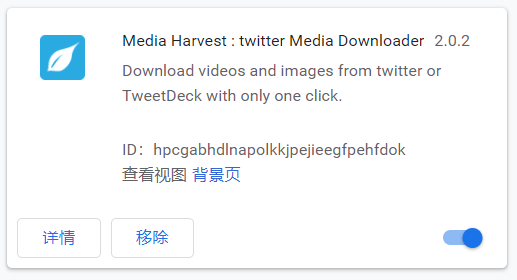

- [Image Downloader](https://chromewebstore.google.com/detail/image-downloader/cnpniohnfphhjihaiiggeabnkjhpaldj)

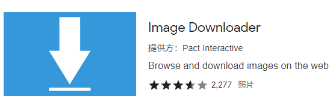

- [DownThemAll!](https://chromewebstore.google.com/detail/downthemall/nljkibfhlpcnanjgbnlnbjecgicbjkge)

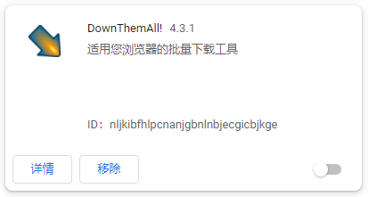

- Double-click Image Downloader

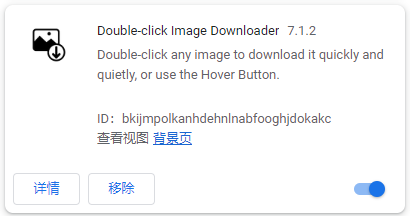

- Patreon Downloader

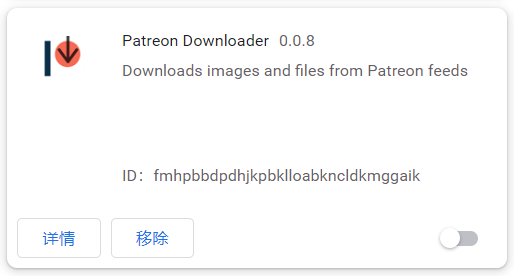

## 不要拦截 Pixiv 的图片

在 Chrome 中，用户可以设置拦截网页上的图片，这样 Chrome 不会下载和显示该网页上的图片。

当 Chrome 拦截了 Pixiv 的图片时，会在地址栏右侧显示一个拦截图标，例如：

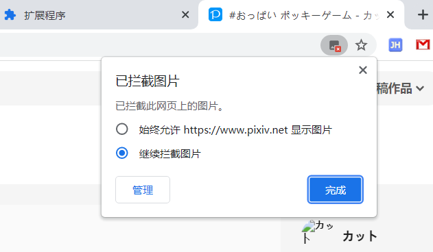

请不要拦截 Pixiv 的图片，否则本程序无法下载图片。
