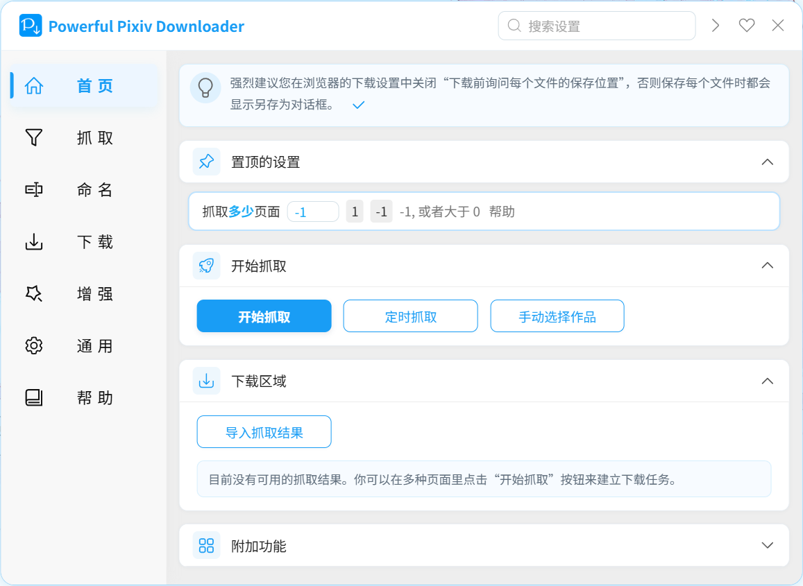
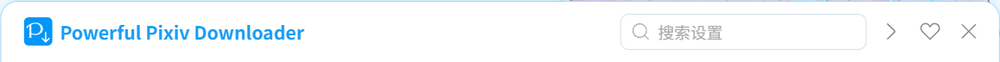
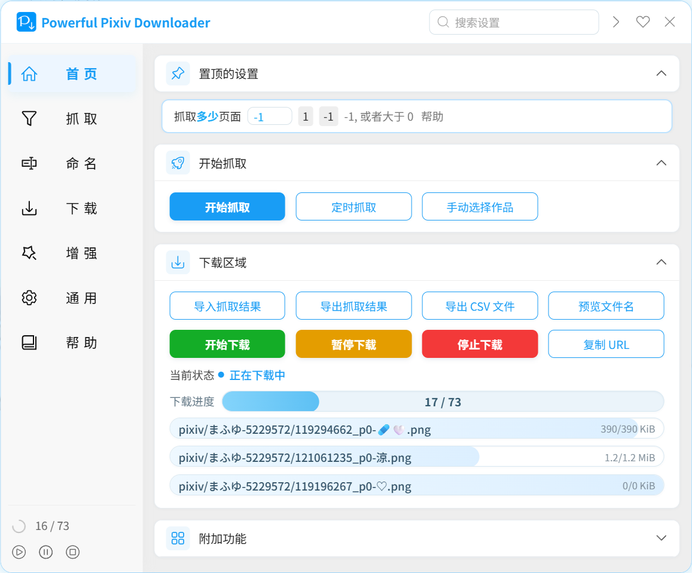
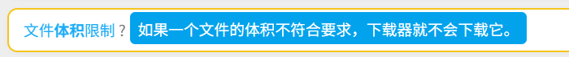
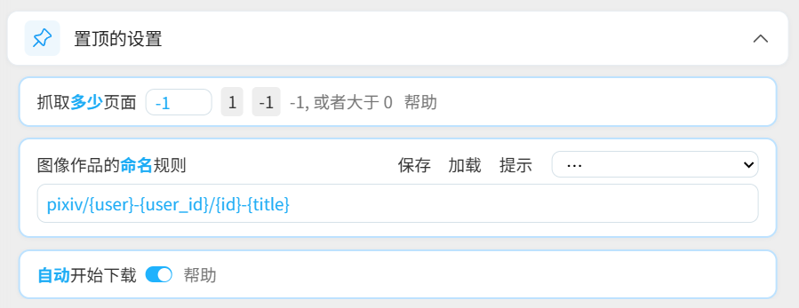
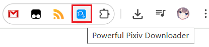

# 了解设置面板

安装本程序后，打开 Pixiv 的网页，可以在右侧看到一个蓝色的按钮：

点击这个按钮可以打开下载器的设置面板，开始抓取和下载。

## 标题栏

在标题栏的右侧有 4 个区域，分别是：
- 搜索栏，可以搜索所有设置项的名字
- 展开或折叠所有设置项
- 赞助我
- 关闭设置面板

## 导航区域

设置面板的左侧是导航区域：

大部分区域都保存着该分类里的设置项。

从上到下依次是：
- `首页`：这是仪表盘，集中显示置顶的设置、开始抓取按钮、下载区域、附加功能按钮。
- `抓取`：保存着抓取相关的设置。
- `命名`：保存着文件名相关的设置。
- `下载`：保存着下载相关的设置。
- `增强`：保存着增强功能的设置。
- `通用`：保存着语言设置、操作方式、外观等与下载无关的设置。
- `帮助`：保存着一些帮助信息和外部链接。

PS：在你进行搜索时，导航区域里会显示一个临时的`搜索`导航，用于显示搜索结果。它平时是不会显示的。

## 下载摘要栏

当抓取完成后，下载器会在导航区域下方显示下载摘要栏：

以前下载器只会在“首页”（仪表盘）里显示下载进度，如果用户处于其他导航分类里，就看不到下载进度。所以我添加了下载摘要栏，它是始终显示的，方便你随时查看下载进度。

它的内容分为两行：
- 第一行显示了下载状态和任务进度
- 第二行显示了三个可点击的按钮，分别是开始下载、暂停下载、停止下载。

## 获取帮助

有些设置的名称后面有一个问号，把鼠标放到名称上就会显示简单的提示，例如：

有些设置的右侧还有“帮助”或“提示”按钮，点击可以查看详细说明。

如果你想在 Wiki 上查看详细说明，可以点击设置项的名字，下载器就会打开对应的 Wiki 页面。

PS：对于首页里的按钮，长按按钮也可以打开它的 Wiki 页面。

## 置顶设置项

下载器有超过 100 个设置，如果你需要频繁使用某些设置，那么每次去翻找它们的效率是很低的。如果你想提高效率，最佳的方法是把常用的设置置顶显示，它们会集中显示在首页的“置顶的设置”区域，例如：

PS：被置顶的设置卡片会有一圈淡蓝色的边框。

**操作方法：**

在设置项的卡片上长按 0.5 秒即可使其置顶，再次长按可以把它取消置顶。 

## 开启和关闭设置面板

有多种方法可以开启和关闭设置面板。

1. 点击网页右侧的这个按钮可以打开设置面板：

点击设置面板右上角的关闭按钮则可以关闭设置面板。

2. 点击本扩展的图标可以切换设置面板的打开/关闭状态。

!>如果当前标签页不是 pixiv.net 的网页，那么点击扩展图标是无效的，因为这个扩展只能在 pixiv.net 使用。

3. 快捷键 `Alt` + `x` 可以切换设置面板的打开/关闭状态。

4. 当设置面板显示时，你可以点击页面的空白区域来关闭它。
