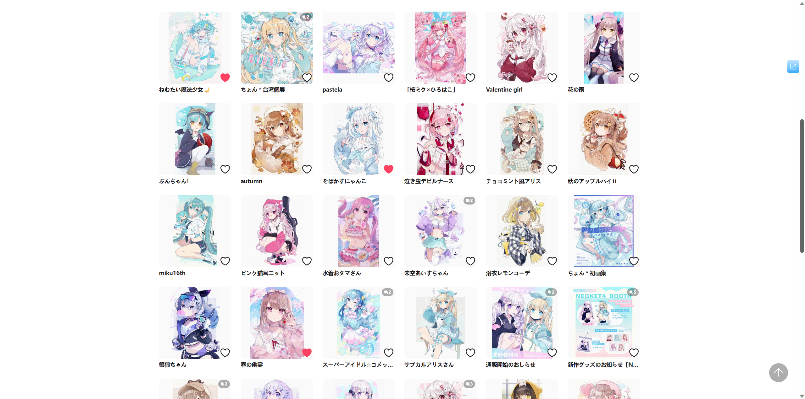
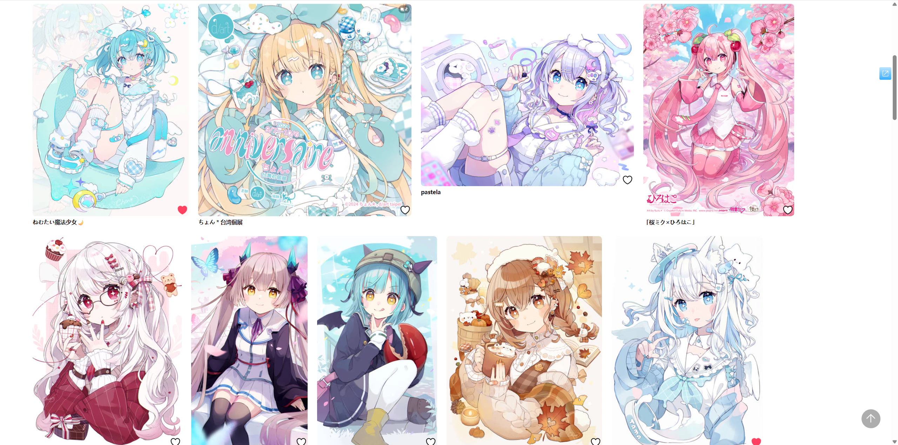
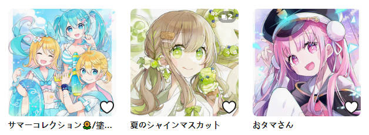
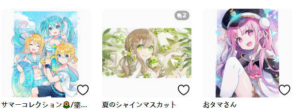
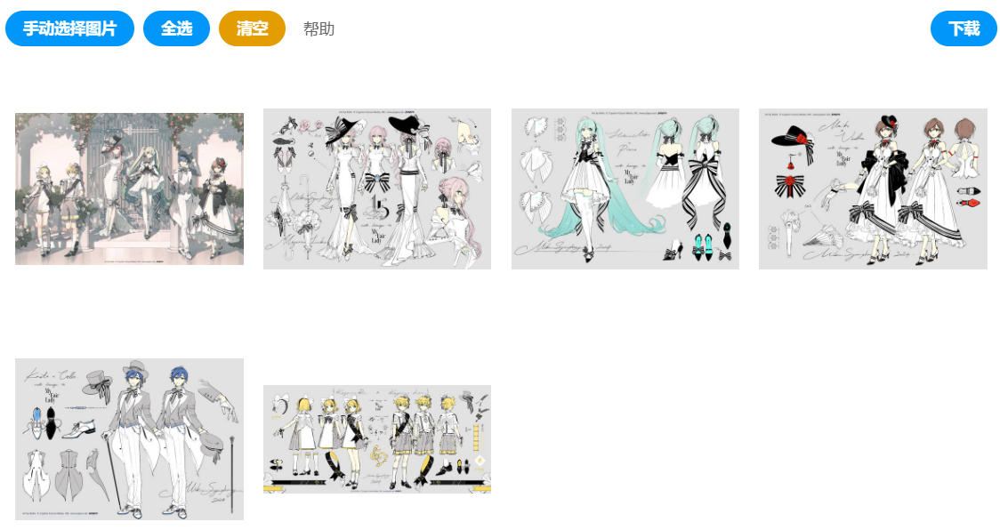
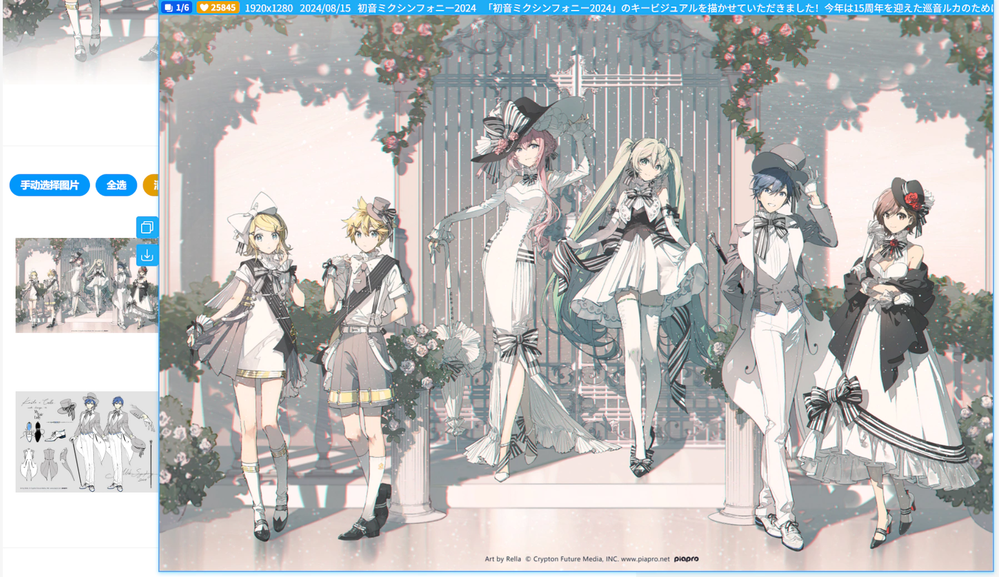
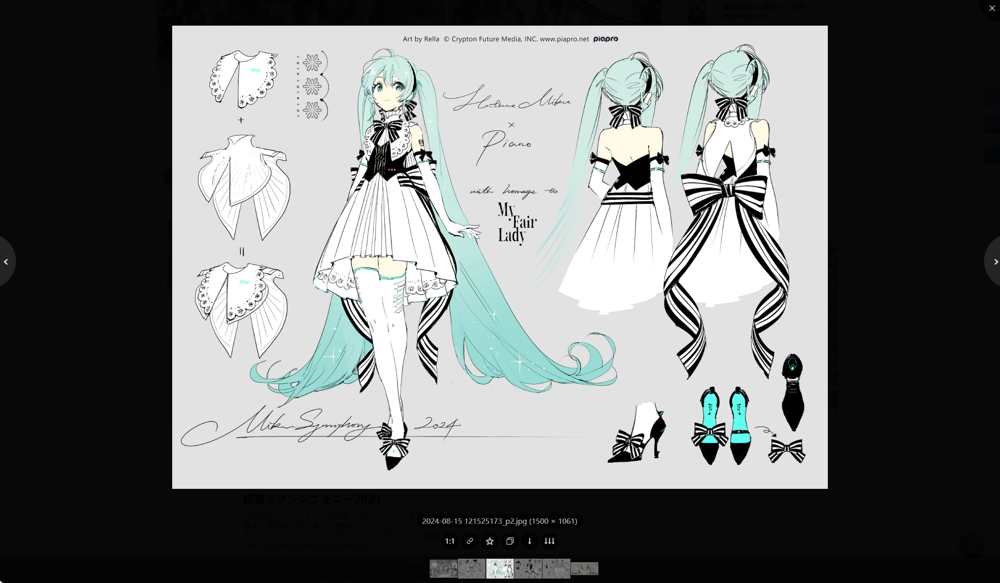

## 显示更大的缩略图

  <a href="/#/zh-cn/设置-增强/缩略图?flag=78" target="_blank" class="settingNameStyle" data-bind-click="true">
    显示更大的缩略图
  </a>
  <input type="checkbox" name="showLargerThumbnails" class="need_beautify checkbox_switch">
  

Pixiv 的作品缩略图比较小，大部分缩略图的显示尺寸通常是 184 px。这是默认情况下的截图：

因为缩略图很小，看不清细节，所以我经常需要点进去查看大图才能知道自己喜不喜欢这张图片。而且看久了也比较累眼。

启用这个功能之后，下载器会增加作品列表容器的宽度，并让缩略图显示为它们的原始大小，这样可以显示更大的缩略图。

?> 根据缩略图的原始尺寸不同，它们的显示尺寸可能变成 250 px、360 px 或 540 px。

如果启用了下面的“替换方形缩略图以显示图片比例”功能，缩略图的尺寸会固定使用 540 px，效果如下：

这样就能看得更清楚了，并且眼睛也会更轻松，不容易累。

?>根据屏幕分辨率和 DPI 缩放不同，一排显示的图片数量也会有所不同。

?>这个功能不太稳定，因为 Pixiv 的代码更新可能会导致此功能在一些页面里失效。

## 替换方形缩略图以显示图片比例

  <a href="/#/zh-cn/设置-增强/缩略图?flag=79" target="_blank" class="settingNameStyle" data-bind-click="true">
    替换方形缩略图以显示图片比例
  </a>
  <input type="checkbox" name="replaceSquareThumb" class="need_beautify checkbox_switch" checked="">
  

pixiv 的缩略图是 250 px 的正方形图片，看不出来图片的比例（横图还是竖图），而且还会裁剪掉边缘区域。例如：

启用这个功能之后，下载器会把方形缩略图替换为 540 px 的缩略图，这样用户可以看到图片的原始比例和全貌。例如：

## 在多图作品页面里显示缩略图列表

  <a href="/#/zh-cn/设置-增强/缩略图?flag=80" target="_blank" class="settingNameStyle" data-bind-click="true">
    在多图作品页面里显示缩略图列表
  </a>
  <input type="checkbox" name="displayThumbnailListOnMultiImageWorkPage" class="need_beautify checkbox_switch" checked="">
  

当你位于**多图作品**页面里时（例如 [121525173](https://www.pixiv.net/artworks/121525173)），下载器可以显示每一张图片的缩略图。例如：

你可以预览、下载每张图片。

### 选择部分图片并下载

缩略图列表的顶部显示了一些按钮。如果你只需要下载这个作品里的部分图片，可以使用这些按钮。

点击“手动选择图片”按钮可以进入/退出手动选择模式。在手动选择模式里，点击一张图片即可选择它，再次点击可以取消选择它。

当你完成选择之后，点击该区域右侧的“下载”按钮即可下载已选择的图片。

?>提示：如果在没有选择任何图片的情况下点击“下载”按钮，下载器会下载所有图片。

### 增强功能

当你把鼠标放在缩略图上时，可以使用一些增强功能，例如：

这些功能包括：
- 复制按钮（点击即可复制作品信息）
- 下载按钮（点击这个按钮只会下载它所在的这一张图片）
- 预览作品（此时你依然可以使用快捷键 `C` 下载单张图片，使用 `D` 下载这个作品）
- 长按鼠标右键时查看大图
- 点击缩略图会打开图片查看器，例如：

## 把图片显示为灰色

  <a href="/#/zh-cn/设置-增强/缩略图?flag=81" target="_blank" class="settingNameStyle" data-bind-click="true">
    把图片显示为灰色
  </a>
  <input type="checkbox" name="imageToGray" class="need_beautify checkbox_switch">
  

这是一个隐藏设置。
