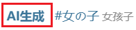
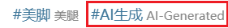
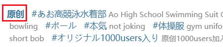
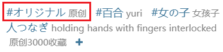

## 作品类型

<div class="option settingsPanel_optionCard" data-no="3" data-pin-bound="true" style="display: flex;">
  <a href="/#/zh-cn/设置-筛选/作品类型?flag=3" target="_blank" class="settingNameStyle" data-bind-click="true">
    <span data-xztext="_作品类型">作品<span class="key">类型</span></span>
  </a>
  <input type="checkbox" name="downType0" id="setWorkType0" class="need_beautify checkbox_common" checked="">
  <span class="beautify_checkbox" tabindex="0" aria-labelledby="setWorkType0"></span>
  <label for="setWorkType0" data-xztext="_插画" class="active">插画</label>
  <input type="checkbox" name="downType1" id="setWorkType1" class="need_beautify checkbox_common" checked="">
  <span class="beautify_checkbox" tabindex="0" data-xztitle="_漫画" title="漫画"></span>
  <label for="setWorkType1" data-xztext="_漫画" class="active">漫画</label>
  <input type="checkbox" name="downType2" id="setWorkType2" class="need_beautify checkbox_common" checked="">
  <span class="beautify_checkbox" tabindex="0"></span>
  <label for="setWorkType2" data-xztext="_动图" class="active">动图</label>
  <input type="checkbox" name="downType3" id="setWorkType3" class="need_beautify checkbox_common" checked="">
  <span class="beautify_checkbox" tabindex="0"></span>
  <label for="setWorkType3" data-xztext="_小说" class="active">小说</label>
</div>

该设置可以筛选你想要下载的作品类型。

下载器在抓取时会检查每个作品的类型，排除不符合条件的作品。

## 年龄限制

<div class="option settingsPanel_optionCard" data-no="4" data-pin-bound="true" style="display: flex;">
  <a href="/#/zh-cn/设置-筛选/作品类型?flag=4" target="_blank" class="settingNameStyle" data-bind-click="true">
    <span data-xztext="_年龄限制"><span class="key">年龄</span>限制</span>
  </a>
  <input type="checkbox" name="downAllAges" id="downAllAges" class="need_beautify checkbox_common" checked="">
  <span class="beautify_checkbox" tabindex="0"></span>
  <label for="downAllAges" data-xztext="_全年龄" class="active">全年龄</label>
  <input type="checkbox" name="downR18" id="downR18" class="need_beautify checkbox_common" checked="">
  <span class="beautify_checkbox" tabindex="0"></span>
  <label for="downR18" class="active"> R-18</label>
  <input type="checkbox" name="downR18G" id="downR18G" class="need_beautify checkbox_common" checked="">
  <span class="beautify_checkbox" tabindex="0"></span>
  <label for="downR18G" class="active"> R-18G</label>
</div>

你可以根据分级限制来筛选作品。

下载器在抓取时会检查每个作品的年龄限制，排除不符合条件的作品。

## AI 作品

<div class="option settingsPanel_optionCard" data-no="5" data-pin-bound="true" style="display: flex;">
  <a href="/#/zh-cn/设置-筛选/作品类型?flag=5" target="_blank" class="settingNameStyle" data-bind-click="true">
    <span data-xztext="_AI作品带高亮"><span class="key">AI</span> 作品</span>
  </a>
  <input type="checkbox" name="AIGenerated" id="AIGenerated" class="need_beautify checkbox_common" checked="">
  <span class="beautify_checkbox" tabindex="0"></span>
  <label for="AIGenerated" data-xztext="_AI生成" class="active">AI 生成</label>
  <input type="checkbox" name="notAIGenerated" id="notAIGenerated" class="need_beautify checkbox_common" checked="">
  <span class="beautify_checkbox" tabindex="0"></span>
  <label for="notAIGenerated" data-xztext="_非AI生成" class="active">非 AI 生成</label>
  <input type="checkbox" name="UnknownAI" id="UnknownAI" class="need_beautify checkbox_common" checked="">
  <span class="beautify_checkbox" tabindex="0"></span>
  <label for="UnknownAI" data-xztext="_未知" class="has_tip active" data-xztip="_AI未知作品的说明" data-tip="早期作品没有标记，无法判断">未知</label>
</div>

你可以根据作品是否由 AI 生成来筛选作品。

下载器在抓取时会检查每个作品的 AI 标记，排除不符合条件的作品。

--------

在用户投稿时，插画、漫画、动图必须选择是否为 AI 生成，小说投稿可选是否为 AI 生成。所以下载器可以判断这些作品是否是 AI 生成的。

如果用户选择了作品是 AI 生成的，Pixiv 会在标签列表前面显示加粗的“AI生成”字样，例如：



如果没有加粗的“AI生成”，就说明用户设置了该作品为“非 AI 生成”。

`未知` 类型是早期作品。因为早期 AI 生成图像的技术没有广泛流传，当时 Pixiv 没有要求作品添加标记，下载器也就无法判断它是不是 AI 生成的。一般来说可以把 `未知` 当做非 AI 生成的作品来看待。

**附加处理：**

由于很多用户故意把 AI 生成图片选择为“非 AI 生成”来逃避监管，所以下载器会检查作品的标签，如果含有特定标签，就会把它视为 AI 生成作品。例如：



这些标签有：

```
AI生成,AI-generated,AIイラスト,AI生成作品,AI 画作,AI生成イラスト,AI 생성,сгенерированный ИИ,สร้างโดย AI,Janaan AI
```

但有些用户故意不添加任何 AI 相关的标签，此时下载器无法通过标签判断它是不是 AI 生成作品。

## 收藏状态

<div class="option settingsPanel_optionCard" data-no="9" data-pin-bound="true" style="display: flex;">
  <a href="/#/zh-cn/设置-筛选/作品类型?flag=9" target="_blank" class="settingNameStyle" data-bind-click="true">
    <span data-xztext="_收藏状态"><span class="key">收藏</span>状态</span>
  </a>
  <input type="checkbox" name="downNotBookmarked" id="setDownNotBookmarked" class="need_beautify checkbox_common" checked="">
  <span class="beautify_checkbox" tabindex="0"></span>
  <label for="setDownNotBookmarked" data-xztext="_未收藏" class="active">未收藏</label>
  <input type="checkbox" name="downBookmarked" id="setDownBookmarked" class="need_beautify checkbox_common" checked="">
  <span class="beautify_checkbox" tabindex="0"></span>
  <label for="setDownBookmarked" data-xztext="_已收藏" class="active">已收藏</label>
</div>

你可以根据作品的收藏状态来筛选作品。

下载器在抓取时会检查每个作品是否被你收藏，排除不符合条件的作品。

## 原创作品

<div class="option settingsPanel_optionCard" data-no="6" data-pin-bound="true" style="display: flex;">
  <a href="/#/zh-cn/设置-筛选/作品类型?flag=6" target="_blank" class="settingNameStyle" data-bind-click="true">
    <span data-xztext="_原创作品"><span class="key">原创</span>作品</span>
  </a>
  <input type="checkbox" name="crawlOriginalWork" id="setCrawlOriginalWork" class="need_beautify checkbox_common" checked="">
  <span class="beautify_checkbox" tabindex="0"></span>
  <label for="setCrawlOriginalWork" data-xztext="_原创" class="active">原创</label>
  <input type="checkbox" name="crawlNonOriginalWork" id="setCrawlNonOriginalWork" class="need_beautify checkbox_common" checked="">
  <span class="beautify_checkbox" tabindex="0"></span>
  <label for="setCrawlNonOriginalWork" data-xztext="_非原创" class="active">非原创</label>
  <span class="verticalSplit"></span>
  <input type="checkbox" name="looseMatchOriginal" id="looseMatchOriginal" class="need_beautify checkbox_common" checked="">
  <span class="beautify_checkbox" tabindex="0"></span>
  <label for="looseMatchOriginal" data-xztext="_宽松匹配" class="active">宽松匹配</label>
</div>

你可以筛选原创作品和非原创作品。

**工作原理：**

用户在投稿时可以设置作品是不是原创的，这会成为作品的一个属性（`isOriginal`）。

对于原创作品，Pixiv 会在标签列表前面显示加粗的“原创”字样，例如：



如果不是原创作品，就没有加粗的“原创”字样。即使它含有原创相关的标签，它也**不是**原创作品，例如：



下载器会先检查作品的 `isOriginal` 属性来判断它是否为原创作品。如果 `isOriginal` 为 `true` 就是原创作品，否则就是非原创作品。

另外，下载器默认启用了 `宽松匹配` 规则：对于非原创作品，如果它含有任意一个特定标签，那么下载器在检查这个过滤时条件时，会把它视为原创作品。这些标签有：

```
原创,原創,創作,オリジナル,Original,original,Creation,creation,창작,오리지널,Asli,ออริจินัล,Оригинал
```

PS：如果你禁用了 `宽松匹配` 规则，那么下载器不会检查标签列表，所以非原创作品永远不会被视为原创作品。

## 来自用户

<div class="option settingsPanel_optionCard new" data-no="114" data-pin-bound="true" style="display: flex;">
  <a href="/#/zh-cn/设置-筛选/作品类型?flag=114" target="_blank" class="settingNameStyle" data-bind-click="true">
    <span data-xztext="_来自用户带高亮">来自<span class="key">用户</span></span>
  </a>
  <input type="checkbox" name="crawlFollowedUsers" id="setCrawlFollowedUsers" class="need_beautify checkbox_common" checked="">
  <span class="beautify_checkbox" tabindex="0"></span>
  <label for="setCrawlFollowedUsers" data-xztext="_已关注的用户" class="active">已关注的用户</label>
  <input type="checkbox" name="crawlNonFollowedUsers" id="setCrawlNonFollowedUsers" class="need_beautify checkbox_common" checked="">
  <span class="beautify_checkbox" tabindex="0"></span>
  <label for="setCrawlNonFollowedUsers" data-xztext="_未关注的用户" class="active">未关注的用户</label>
  <span class="settingsPanel_newBadge" aria-hidden="true">
    <svg class="icon settingsPanel_newBadgeIcon" aria-hidden="true">
      <use xlink:href="#new"></use>
    </svg>
  </span>
</div>

使用这个设置，你可以只下载已关注用户的作品，也可以只下载未关注用户的作品。

## 图片数量

<div class="option settingsPanel_optionCard" data-no="8" data-pin-bound="true" style="display: flex;">
  <a href="/#/zh-cn/设置-筛选/作品类型?flag=8" target="_blank" class="settingNameStyle" data-bind-click="true">
    <span data-xztext="_图片数量">图片<span class="key">数量</span></span>
  </a>
  <input type="checkbox" name="downSingleImg" id="setDownSingleImg" class="need_beautify checkbox_common" checked="">
  <span class="beautify_checkbox" tabindex="0"></span>
  <label for="setDownSingleImg" data-xztext="_单图作品" class="active">单图作品</label>
  <input type="checkbox" name="downMultiImg" id="setDownMultiImg" class="need_beautify checkbox_common" checked="">
  <span class="beautify_checkbox" tabindex="0"></span>
  <label for="setDownMultiImg" data-xztext="_多图作品" class="active">多图作品</label>
</div>

你可以根据图片数量来筛选作品。

下载器在抓取时会检查此设置，排除不符合条件的作品。

单图作品指只有一张图片的作品；多图作品是指包含有多张图片的作品，它们通常在右上角有标记，例如：


## 图片色彩

<div class="option settingsPanel_optionCard" data-no="7" data-pin-bound="true" style="display: flex;">
  <a href="/#/zh-cn/设置-筛选/作品类型?flag=7" target="_blank" class="settingNameStyle" data-bind-click="true">
    <span data-xztext="_图片色彩">图片<span class="key">色彩</span></span>
  </a>
  <input type="checkbox" name="downColorImg" id="setDownColorImg" class="need_beautify checkbox_common" checked="">
  <span class="beautify_checkbox" tabindex="0"></span>
  <label for="setDownColorImg" data-xztext="_彩色图片" class="active">彩色图片</label>
  <input type="checkbox" name="downBlackWhiteImg" id="setDownBlackWhiteImg" class="need_beautify checkbox_common" checked="">
  <span class="beautify_checkbox" tabindex="0"></span>
  <label for="setDownBlackWhiteImg" data-xztext="_黑白图片" class="active">黑白图片</label>
  <span class="verticalSplit"></span>
  <span data-xztext="_彩色占比阈值">彩色占比阈值</span>
  <input type="text" name="coloredRatio" class="setinput_style blue w50" value="25">
  <span>%</span>
</div>

你可以根据图片的颜色来筛选作品。一个常见的适用场景是排除黑白的漫画图片。

如果你设置了过滤彩色或黑白图片，过滤器会检查图片的颜色，判断这个图片是彩色的还是黑白的。下载器在抓取时和下载时都会检查此设置。

**判断方式：**

下载器在检查图片的颜色时，会忽略白色和透明像素，只统计彩色、灰色、黑色像素。这是因为人眼在判断图片是否为彩色时，通常不会在意白色区域，重点在于其他内容是不是彩色。去掉白色区域之后，准确度会更高。

然后下载器会计算彩色像素的占比，和“彩色占比阈值”进行比较：如果一张图片的彩色像素占比大于阈值，就把它视为彩色图片；否则视为黑白图片。

**彩色占比阈值：**

在有些图片里，彩色、灰色、黑色可能都占据了一定比例。

- 如果你**加大**彩色占比的阈值，图片会更容易被视为黑白图片。
- 如果你**减小**彩色占比的阈值，图片会更容易被视为彩色图片。

阈值为 25% 时的粗略参考数据：

- 抓取插画和动图时，大约有 10% - 20% 的图片被视为黑白图片。
- 抓取漫画时，大约有 50% 左右的图片被视为黑白图片。

?>有些图片虽然大部分是黑白的，但还是带有一些彩色（彩色区域占比有时甚至可以达到 30%），这样的图片是彩色图片，不属于黑白图片。另外，如果黑白图片的线条是彩色的，或者使用了较浅的背景颜色，那么它也可能会被视为彩色图片。

?>相较而言，下载器很少会把彩色图片误判为黑白图片，除非灰色、黑色的占比确实很多。

**检查时机：**

- 如果你没有排除某种颜色的图片，那么下载器就不会检查图片的颜色。
- 如果你排除了某种颜色的图片，那么下载器在抓取和下载时都会进行检查。在抓取阶段，下载器会加载图片的缩略图进行检查，如果不符合要求，就不会保存这张图片；在下载阶段，下载器会在下载图片后再次检查它的颜色，不符合要求的话就不会把它保存到硬盘上。

下载时，如果某个文件因为颜色而被排除，日志里会显示对应的提示。例如：

<span class="log" style="color: rgb(210, 126, 0);"><a href="https://www.pixiv.net/i/134469561#1" target="_blank">134469561_p0</a> 没有被保存，因为它的颜色不符合设定。<br></span>

## 图片格式

<div class="option settingsPanel_optionCard new" data-no="112" data-pin-bound="true" style="display: flex;">
  <a href="/#/zh-cn/设置-筛选/作品类型?flag=112" target="_blank" class="settingNameStyle" data-bind-click="true">
    <span data-xztext="_图片格式">图片<span class="key">格式</span></span>
  </a>
  <input type="checkbox" name="downJPGImg" id="downJPGImg" class="need_beautify checkbox_common" checked="">
  <span class="beautify_checkbox" tabindex="0"></span>
  <label for="downJPGImg" class="active"> .jpg </label>
  <input type="checkbox" name="downPNGImg" id="downPNGImg" class="need_beautify checkbox_common" checked="">
  <span class="beautify_checkbox" tabindex="0"></span>
  <label for="downPNGImg" class="active"> .png </label>
  <span class="settingsPanel_newBadge" aria-hidden="true">
    <svg class="icon settingsPanel_newBadgeIcon" aria-hidden="true">
      <use xlink:href="#new"></use>
    </svg>
  </span>
</div>

*该设置的说明与下载器里的说明完全一致。*

你可以根据需要，决定是否下载 `.jpg` 和 `.png` 格式的图片。

备注：

该设置只会检查插画和漫画里的图片，不会检查动图和小说里的图片。
