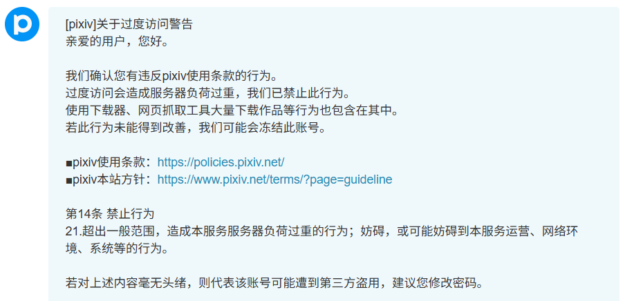
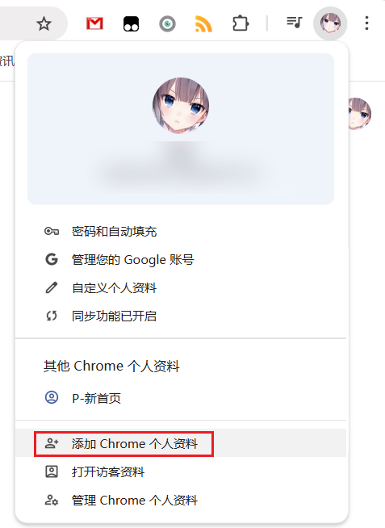
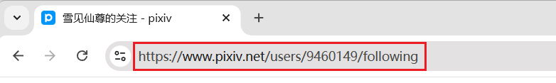
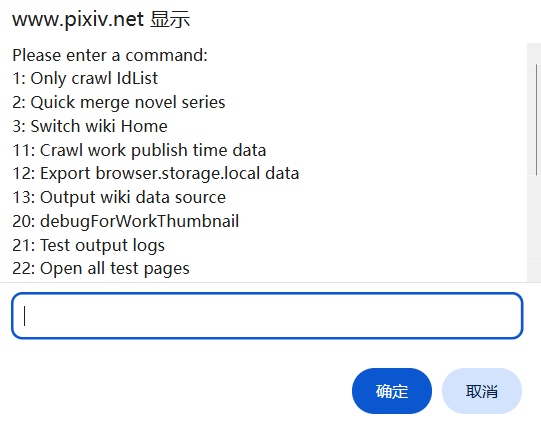
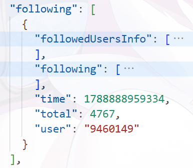
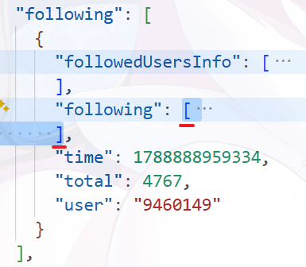

# 账号被封禁的风险

## 原因

因为 Pixiv 对请求频率有限制，所以当你使用下载器连续发送大量请求时，有可能导致你的 Pixiv 账号被警告或者封禁。

这些行为有可能会导致风险：
- 大量抓取作品
- 大量下载文件
- 批量添加很多收藏
- 批量关注很多用户

?> 根据目前的经验，每天下载几百个作品通常不会被警告。

## Pixiv 的处理方式

如果你经常大量下载文件，例如每天都下载几千、几万个作品，可能会被 Pixiv 警告。在第一次触发警告时你会收到一封站内信，内容可能如下：

在大量下载时，下载器每保存 100 个文件，就会检测一次你是否收到了这种站内信。如果在最近 1 小时内你收到了这种站内信，下载器就会暂停下载，避免事态变得更糟糕。

如果你的账号被第二次警告，可能有不同的情况：
- 如果第一次警告是几年前的了，那么第二次警告可能只是提示，没有实际作用。假如你在 2022 年被警告了一次，在 2025 年被警告第二次，账号功能可能不会受到任何限制。
- 但如果两次警告的时间相隔的时间比较近（我不清楚具体的阈值），那么你的账号可能面临以下两种情况：
  - 较轻的处置：你的账号被冻结，不能关注用户和收藏作品，但其他功能正常（可以正常浏览、抓取和下载）。如果你遇到了这种情况，可以尝试给客服发邮件申请解封，有可能恢复正常。
  - 严重的处置：你的账号会被删除，无法登录，也不能申请解封。由于你的账号已经不存在，所以其他用户也无法查看你的主页、收藏等内容。

在几年前，Pixiv 经常会使用较轻的处置，但近来经常会删除账号，这表明 Pixiv 加大了对违规行为的处置力度。

!> 如果你的账号被封禁，我不会对此负责。不过下载器也有一些设置来减慢抓取和下载的速度，可以降低被封禁的可能性。

## 如何降低风险

经常有人问我：每天下载多少个作品不会被警告？实际上这没有固定的数值，因为触发警告的条件不仅取决于作品数量，还取决于请求的频率。

如果请求频率很高，那么下载几百个作品就有可能触发警告。相反，如果降低请求频率，可能下载几千个作品也不会被警告。

当你需要抓取和下载超过几千个作品时，有一些可以降低风险的方法：

### 减慢速度

下载器有一些设置可以降低被警告的可能性：
- 下载器默认会 [减慢抓取速度](/zh-cn/设置-筛选/执行策略?id=减慢抓取速度)。在抓取大量作品时，下载器会每隔一定时间发送一次请求。
- 当你需要下载大量文件时，你可以设置下载时的 [下载间隔](/zh-cn/设置-下载/下载行为?id=下载间隔)，降低下载频率。

上面两个设置都可以自定义间隔时间。如果你每天只抓取和下载几百个作品，默认的间隔时间通常是安全的。

你要抓取和下载的文件数量越多，就应该设置越大的间隔时间。在极端情况下，你可以考虑设置 4 秒钟左右的间隔时间（当然，这会增加任务完成的时间）。

### 分批下载

假设你想下载你的所有收藏，它们有几百页或更多。你可以分多次进行，每次只抓取 50 或 100 页。

具体方法可以查看：[分批抓取和下载（拆分任务）](/zh-cn/使用技巧?id=分批抓取和下载（拆分任务）)。

### 使用小号

如果你经常下载大量文件，上面的设置并不能完全保证安全。你可以使用小号来下载。大号只在日常浏览时下载少量文件，小号则专门用来进行大量下载，并且需要配合上面的方法使用。

?> 小号可以抓取大号的公开收藏、关注的用户，只要打开对应的网址即可。因此你可以正常使用大号关注用户、收藏作品，并在需要时使用小号来下载。

#### 注册小号

你可以使用多个邮箱地址来注册多个账号。

#### 在独立的环境里使用小号

你可以使用多个浏览器，例如 Chrome 登录大号，Edge 登录小号。

不过我更推荐只使用一个浏览器，这样更方便。

点击浏览器右上角的头像按钮，即可新建一个配置（本地浏览器用户）。例如 Chrome 浏览器可以从这里添加新的个人资料：

当你使用新添加的浏览器用户时，Chrome 会打开一个独立的浏览器窗口，你可以在里面登录小号，并安装这个扩展程序来使用。

#### 如何下载大号的数据

如果你想下载大号的关注、收藏，可以先用大号进入对应的页面，然后复制地址栏里的 URL，例如：

在小号的浏览器里粘贴 URL 并回车，就可以进入大号的对应页面里，进行抓取和下载。

不过这个方法只能下载大号**公开**的关注和收藏。所以如果你打算使用小号下载大号的数据，就应该公开这些数据。

## 下载途中被封号了怎么办

如果你的账号在下载途中被封号了，还有一些文件没有下载完，那么你可以这样做：

首先，不要点击“停止下载”按钮，这样你可以通过下载器的断点续传功能恢复下载进度。然后依次执行以下步骤：

- 从浏览器的地址栏里复制当前页面的网址
- 在**同一个**浏览器窗口里登录另一个 Pixiv 账号
- 刷新之前正在下载的页面，或者在地址栏里粘贴网址，打开该页面
- 下载器应该会恢复任务进度，所以你可以继续下载。

这是因为下载器有 [断点续传功能](zh-cn/常见问题?id=是否支持断点续传)，所以可以恢复同一个网址里未完成的下载任务。

----------

如果你已经点击了“停止下载”按钮，那么你应该点击“导出抓取结果”按钮，导出这次的抓取结果（JSON 文件）。

当你登录了新的 Pixiv 账号之后，可以导入抓取结果，重新下载这些文件。

参考：[导出抓取结果](/zh-cn/按钮-下载区域/抓取结果?id=导出抓取结果)

## 账号被封禁后，如何导出关注用户列表

当你的账号可以正常使用时，你可以这样导出（备份）关注列表：

进入你的关注页面，然后打开下载器的面板，点击“附加功能”区域里的 [导出关注的用户列表（JSON）](/zh-cn/按钮-附加功能/关注页面?id=导出关注的用户列表（json）) 按钮。

你可以选择导出 CSV 格式或者 JSON 格式，也可以全部导出。要在将来恢复关注列表的话，需要使用 JSON 格式。

--------

如果你的账号已经被封禁，但是你在之前没有备份关注列表，可以从下载器的缓存里获取关注列表。操作步骤如下：

打开一个 Pixiv 的网页，然后在键盘上直接输入口令 `ppdtask`。

?>提示：你不需要定位到任何输入框里。打开网页后，依次按下键盘上的 `ppdtask` 即可。

之后下载器会显示一个命令列表，如图所示：

在它底部的输入框里输入 `12` 并点击确定按钮，下载器就会导出一个 JSON 文件，文件名是 `Powerful Pixiv Downloader browser.storage.local.json`。这是下载器内部保存的设置和关注列表数据。

使用代码编辑器打开这个 JSON 文件，其中的 `following` 数组保存着你的关注列表。如图所示：

备注：如果你在这个浏览器里登录过多个 Pixiv 账号，下载器可能会保存多个账号的关注列表。此时你可以通过 `user`（你的用户 ID）和 `total`（关注用户总数）来区分不同账号。

`following` 里的 `followedUsersInfo` 和 `following` 数组都可以用来恢复关注列表，你可以任选其一使用。以 `following` 为例，你可以选中它的内容（从 `[` 开始，到 `]` 结束，不包括最后的逗号 `,`）:

然后复制选中的内容，新建一个文件，粘贴，然后保存为一个扩展名为 `.json` 的文件，文件名随意。这就是你的关注列表。

如果你没有代码编辑器，也可以尝试让 AI 帮你提取数据。

如果你要在新的账号里恢复关注列表的话，可以这样做：
- 登录新账号
- 进入关注页面
- 点击“附加功能”里的 [批量关注用户（JSON）](/zh-cn/按钮-附加功能/关注页面?id=批量关注用户（json）) 按钮，选择刚才保存的 JSON 文件即可。
